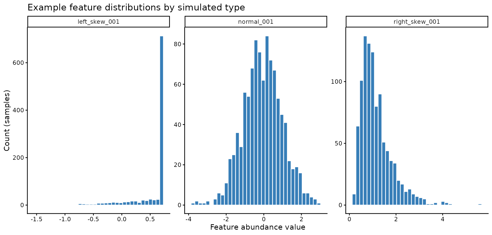
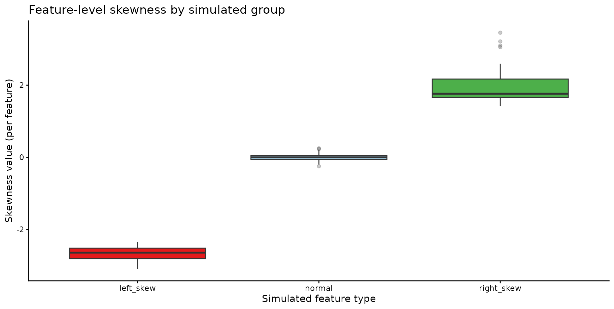
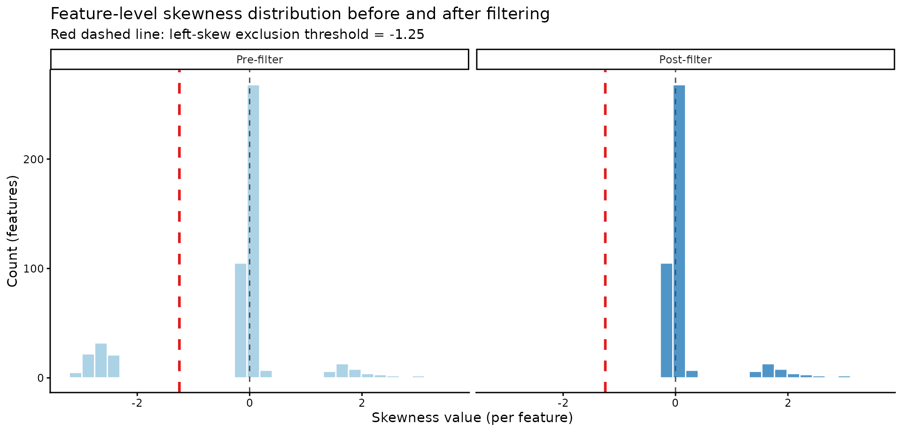
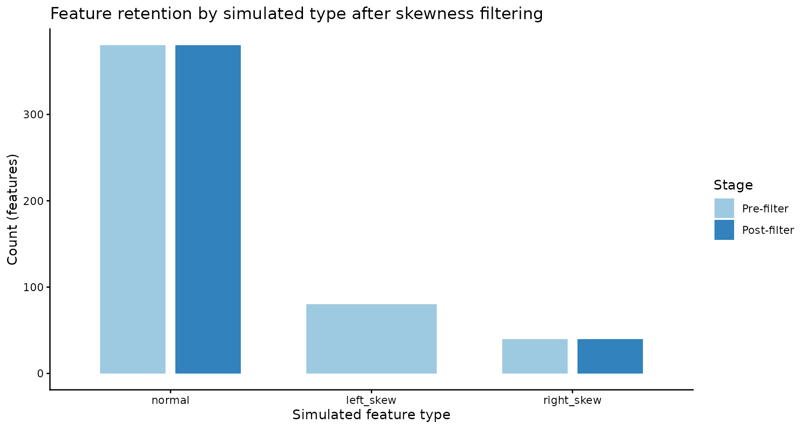
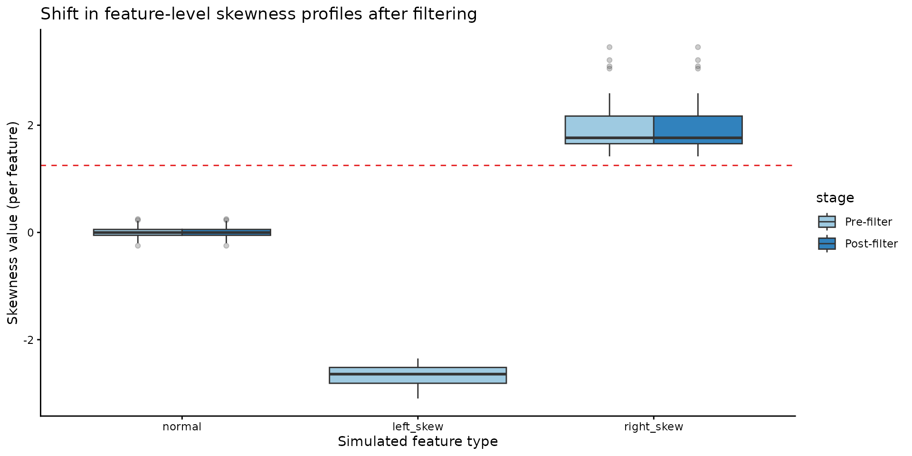
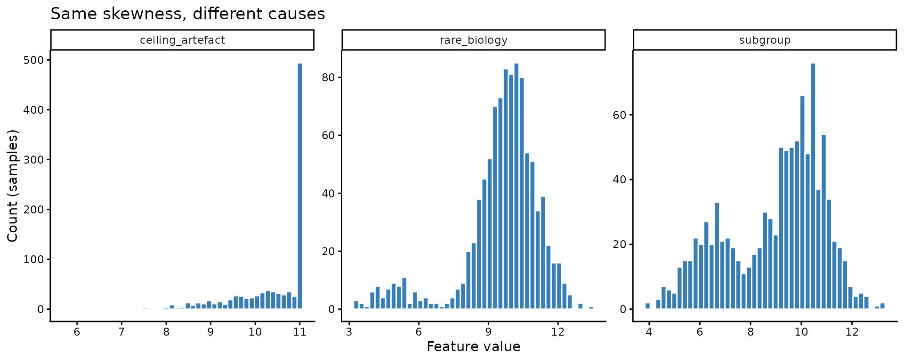

# Skewness-Based Feature QC

## Upper limit of quantification (skewness)

Some measurement platforms have upper limits of quantification which can
result in skewed data with ceiling effects. In this vignette we:

1.  simulate a dataset (`1000` samples x `500` features),
2.  show 3 feature types (normal, left-skew, right-skew),
3.  explain what skewness means,
4.  run skewness filtering in
    [`quality_control()`](https://mrcieu.github.io/omiprep/reference/quality_control.md),
5.  visualize pre/post filtering impact,
6.  and show what this criterion **cannot** tell you, and how to avoid
    removing biologically meaningful features.

### This filter is off by default

`feature_skewness_threshold` is `NULL` unless you set it, and
[`quality_control()`](https://mrcieu.github.io/omiprep/reference/quality_control.md)
excludes nothing on the basis of skewness while it is `NULL`. There is
no recommended default value, because no single cutoff is appropriate
across platforms, scales and sample sizes.

Treat it as an **opt-in diagnostic for a specific, platform-driven
artefact** — upper-end truncation — rather than as a routine filtering
step. It is most likely to be useful for affinity-based proteomic
assays, where an upper limit of quantification or assay non-linearity
can compress the top of a feature’s range. It is least likely to be
appropriate for untransformed abundance data, where positive skew is the
norm and carries no implication of assay failure, and for small sample
sizes, where the estimate itself is unreliable.

Section 5 shows why the output of this filter should be inspected rather
than applied unexamined.

``` r

library(omiprep)
library(ggplot2)

set.seed(20260408)
```

## 1) Simulate Data (1000 Samples x 500 Features)

We create 3 feature groups:

- `normal`: approximately symmetric distributions,
- `left_skew`: features with upper-end truncation (mimicking ceiling
  effects),
- `right_skew`: positively skewed features.

``` r

n_samples <- 1000
n_normal <- 380
n_left_skew <- 80
n_right_skew <- 40
stopifnot(n_normal + n_left_skew + n_right_skew == 500)

# 1) approximately symmetric features
normal_block <- matrix(
  rnorm(n_samples * n_normal, mean = 0, sd = 1),
  nrow = n_samples,
  ncol = n_normal
)

# 2) left-skew features generated via upper-end truncation
left_raw <- matrix(
  rnorm(n_samples * n_left_skew, mean = 1.2, sd = 0.9),
  nrow = n_samples,
  ncol = n_left_skew
)
upper_limit <- 0.7
left_skew_block <- pmin(left_raw, upper_limit)

# 3) right-skew features
right_block <- matrix(
  rlnorm(n_samples * n_right_skew, meanlog = 0, sdlog = 0.55),
  nrow = n_samples,
  ncol = n_right_skew
)

data <- cbind(normal_block, left_skew_block, right_block)

colnames(data) <- c(
  paste0("normal_", sprintf("%03d", seq_len(n_normal))),
  paste0("left_skew_", sprintf("%03d", seq_len(n_left_skew))),
  paste0("right_skew_", sprintf("%03d", seq_len(n_right_skew)))
)
rownames(data) <- paste0("sample_", seq_len(n_samples))

samples <- data.frame(sample_id = rownames(data))
features <- data.frame(
  feature_id = colnames(data),
  simulated_group = c(
    rep("normal", n_normal),
    rep("left_skew", n_left_skew),
    rep("right_skew", n_right_skew)
  )
)
```

Representative distributions for one feature from each group:

``` r

inspect_features <- c("normal_001", "left_skew_001", "right_skew_001")
plot_df <- data.frame(
  feature = rep(inspect_features, each = n_samples),
  value = as.vector(data[, inspect_features, drop = FALSE])
)

ggplot(plot_df, aes(x = value)) +
  geom_histogram(bins = 35, fill = "#377EB8", color = "white") +
  facet_wrap(~feature, scales = "free", nrow = 1) +
  theme_classic() +
  labs(
    x = "Feature abundance value",
    y = "Count (samples)",
    title = "Example feature distributions by simulated type"
  )
```



This is the key motivation: some individual **features** have visibly
skewed distributions. In the above we can see how the distribution of
feature `001` changes based on the simulation; we will focus on the
`left_skew` data.

## 2) What skewness means (per feature)

`omiprep` computes skewness **for each feature across samples** using
[`psych::describe()`](https://rdrr.io/pkg/psych/man/describe.html) and
takes the `skew` column (default `type = 3` in
[`psych::skew`](https://rdrr.io/pkg/psych/man/skew.html)):

``` math
\mathrm{skew} = \frac{\sum_{i=1}^{n} (x_i-\bar{x})^3}{n \cdot s^3}
```

where $`x_i`$ are sample values for one feature, $`\bar{x}`$ is the
feature mean, $`s`$ is the feature SD, and $`n`$ is the number of
non-missing sample values.

Plain-language interpretation:

- `skew < 0` (`left_skew`): most values are concentrated on the right
  side, with a tail extending to the left.
- `skew > 0` (`right_skew`): most values are concentrated on the left
  side, with a tail extending to the right.
- larger `abs(skew)` means stronger asymmetry.

### Missing values, sample size, and scale

Three properties of the estimate matter when interpreting it:

- **Missing values** are dropped feature-wise (`na.rm = TRUE`). Nothing
  is imputed, and $`n`$ therefore differs between features. A feature
  measured in a third of samples is compared against one measured in all
  of them.
- **No minimum sample size is imposed.** A feature with only a few
  non-missing values still returns an estimate, and skewness from a
  small $`n`$ is unstable. Because sparse features are often the
  biologically interesting ones, apply the missingness filter first and
  treat skewness for sparsely measured features with particular caution.
  Features with zero variance return `NaN` and are never flagged.
- **Skewness is not invariant to transformation.** It is calculated on
  the values as supplied. Within
  [`quality_control()`](https://mrcieu.github.io/omiprep/reference/quality_control.md)
  this is the `qc` layer, after missingness filtering, on whatever scale
  the data are already on — no transformation is applied. The same
  feature can be strongly skewed on a raw intensity scale and
  near-symmetric after a log transformation, so a threshold chosen for
  one scale does not carry over to the other.

### What the threshold means

The threshold is a **cutoff on skewness magnitude**, not a p-value.

- With `direction = "left"`, a feature is excluded if
  `skew <= -threshold`.
- With `direction = "right"`, a feature is excluded if
  `skew >= threshold`.
- With `direction = "both"`, a feature is excluded if
  `abs(skew) >= threshold`.

So for `threshold = 1.25` and `direction = "left"`, features with
skewness `<= -1.25` are flagged/excluded.

The helper
[`feature_skewness()`](https://mrcieu.github.io/omiprep/reference/feature_skewness.md)
returns one row per feature:

``` r

skew_df <- feature_skewness(
  data = data,
  threshold = 1.25,
  direction = "left"
)
skew_df$simulated_group <- features$simulated_group[match(skew_df$feature_id, features$feature_id)]

head(skew_df[order(skew_df$skew), ], 10)
#>        feature_id      skew exclude_by_skewness simulated_group
#> 384 left_skew_004 -3.097501                TRUE       left_skew
#> 390 left_skew_010 -3.085930                TRUE       left_skew
#> 392 left_skew_012 -3.056769                TRUE       left_skew
#> 382 left_skew_002 -3.020733                TRUE       left_skew
#> 388 left_skew_008 -3.009804                TRUE       left_skew
#> 383 left_skew_003 -2.941145                TRUE       left_skew
#> 439 left_skew_059 -2.936271                TRUE       left_skew
#> 389 left_skew_009 -2.934770                TRUE       left_skew
#> 429 left_skew_049 -2.929402                TRUE       left_skew
#> 447 left_skew_067 -2.927903                TRUE       left_skew
```

Skewness distributions by simulated group; we can see that the normally
distributed features are mostly around `skew = 0`, the left-skewed
features have negative skewness values (many below `-1.25`), and the
right-skewed features have positive skewness values.

``` r

ggplot(skew_df, aes(x = simulated_group, y = skew, fill = simulated_group)) +
  geom_boxplot(outlier.alpha = 0.25) +
  theme_classic() +
  scale_fill_manual(values = c(
    normal = "#9ECAE1",
    left_skew = "#E41A1C",
    right_skew = "#4DAF4A"
  )) +
  guides(fill = "none") +
  labs(
    x = "Simulated feature type",
    y = "Skewness value (per feature)",
    title = "Feature-level skewness by simulated group"
  )
```



## 3) Apply a skewness filtering rule

To keep this vignette fast while using `1000 x 500` data, we apply the
same feature-level rule directly:

``` r


skew_rule <- feature_skewness(
  data = data,
  threshold = 1.25,
  direction = "left"
)

excluded_skew <- skew_rule$feature_id[skew_rule$exclude_by_skewness %in% TRUE]
```

How many features are excluded by skewness?

``` r

length(excluded_skew)
#> [1] 80
head(excluded_skew, 20)
#>  [1] "left_skew_001" "left_skew_002" "left_skew_003" "left_skew_004"
#>  [5] "left_skew_005" "left_skew_006" "left_skew_007" "left_skew_008"
#>  [9] "left_skew_009" "left_skew_010" "left_skew_011" "left_skew_012"
#> [13] "left_skew_013" "left_skew_014" "left_skew_015" "left_skew_016"
#> [17] "left_skew_017" "left_skew_018" "left_skew_019" "left_skew_020"
```

Exclusions by simulated feature type:

``` r

excluded_tbl <- data.frame(feature_id = excluded_skew)
excluded_tbl$simulated_group <- features$simulated_group[match(excluded_tbl$feature_id, features$feature_id)]
table(excluded_tbl$simulated_group, useNA = "ifany")
#> 
#> left_skew 
#>        80
```

``` r

m <- Omiprep(data = data, samples = samples, features = features)

m_qc <- quality_control(
  omiprep = m,
  source_layer = "input",
  sample_missingness = 0.2,
  feature_missingness = 0.2,
  feature_skewness_threshold = 1.25,
  feature_skewness_direction = "left",
  total_sum_abundance_sd = NA,
  outlier_udist = 5,
  pc_outlier_sd = NA, 
  cores = 2, 
  fast = FALSE
)
#> 
#> ── Starting Omics QC Process ───────────────────────────────────────────────────
#> ℹ Validating input parameters
#> ✔ Validating input parameters [11ms]
#> 
#> ℹ Sample & Feature Summary Statistics for raw data
#> ℹ Number of informative PCs (Scree acceleration factor): 3
#> ℹ Sample & Feature Summary Statistics for raw data✔ Sample & Feature Summary Statistics for raw data [37.9s]
#> 
#> ℹ Copying input data to new 'qc' data layer
#> ✔ Copying input data to new 'qc' data layer [45ms]
#> 
#> ℹ Assessing for extreme sample missingness >=80% - excluding 0 sample(s)
#> ✔ Assessing for extreme sample missingness >=80% - excluding 0 sample(s) [37ms]
#> 
#> ℹ Assessing for extreme feature missingness >=80% - excluding 0 feature(s)
#> ✔ Assessing for extreme feature missingness >=80% - excluding 0 feature(s) [30m…
#> 
#> ℹ Assessing for sample missingness at specified level of >=20% - excluding 0 sa…
#> ✔ Assessing for sample missingness at specified level of >=20% - excluding 0 sa…
#> 
#> ℹ Assessing for feature missingness at specified level of >=20% - excluding 0 f…
#> ✔ Assessing for feature missingness at specified level of >=20% - excluding 0 f…
#> 
#> ℹ Assessing for feature skewness at threshold <= -1.25 - excluding 0 feature(s)
#> ✔ Assessing for feature skewness at threshold <= -1.25 - excluding 80 feature(s…
#> 
#> ℹ Running sample data PCA outlier analysis at +/- 5 Sdev
#> ✔ Running sample data PCA outlier analysis at +/- 5 Sdev [26ms]
#> 
#> ℹ Creating final QC dataset...
#> ℹ Number of informative PCs (Scree acceleration factor): 6
#> ℹ Creating final QC dataset...
#> ℹ Creating final QC dataset...── Step timings ──
#> ℹ Creating final QC dataset...
#> ℹ Creating final QC dataset...
#>                         step seconds   pct
#>                   validation    0.00   0.0
#>                summarise_raw   37.87  57.3
#>                   copy_layer    0.02   0.0
#>   extreme_sample_missingness    0.02   0.0
#>  extreme_feature_missingness    0.02   0.0
#>           sample_missingness    0.01   0.0
#>          feature_missingness    0.25   0.4
#>              summarise_final   27.39  41.5
#>                        total   66.07 100.0
#> ✔ Creating final QC dataset... [27.7s]
#> 
#> ℹ 'Omics QC Process Completed
#> ✔ 'Omics QC Process Completed [12ms]
```

## 4) Post-filtering impact on distributions

All plots below are feature-level summaries (counting features), except
where explicitly stated.

``` r

included_features <- setdiff(colnames(data), excluded_skew)

pre_skew <- feature_skewness(data, threshold = NULL)

post_matrix <- data[, included_features, drop = FALSE]
post_skew <- feature_skewness(post_matrix, threshold = NULL)

pre_skew$stage  <- factor("Pre-filter",  levels = c("Pre-filter", "Post-filter"))
post_skew$stage <- factor("Post-filter", levels = c("Pre-filter", "Post-filter"))
skew_compare <- rbind(
  pre_skew[, c("feature_id", "skew", "stage")],
  post_skew[, c("feature_id", "skew", "stage")]
)
```

### 4a) Feature-skewness distribution before vs after filtering

``` r

params_used <- attributes(m_qc@data)
skewness_threshold <- ifelse(params_used$qc_feature_skewness_direction=="left", 
                             -1 * params_used$qc_feature_skewness_threshold, 
                              1 * params_used$qc_feature_skewness_threshold)

ggplot(skew_compare, aes(x = skew, fill = stage)) +
  geom_histogram(bins = 30, color = "white", alpha = 0.85) +
  facet_wrap(~stage, nrow = 1) +
  geom_vline(xintercept = 0, color = "#4D4D4D", linetype = "dashed") +
  geom_vline(xintercept = skewness_threshold, color = "#E41A1C", linetype = "dashed", linewidth = 1) +
  theme_classic() +
  scale_fill_manual(values = c("Pre-filter" = "#9ECAE1", "Post-filter" = "#3182BD")) +
  guides(fill = "none") +
  labs(
    x = "Skewness value (per feature)",
    y = "Count (features)",
    title = "Feature-level skewness distribution before and after filtering",
    subtitle = paste0("Red dashed line: left-skew exclusion threshold = ", skewness_threshold)
  )
```



### 4b) Feature retention by simulated type

``` r

pre_counts <- as.data.frame(table(features$simulated_group), stringsAsFactors = FALSE)
names(pre_counts) <- c("simulated_group", "n")
pre_counts$stage <- factor("Pre-filter",  levels = c("Pre-filter", "Post-filter"))

post_counts <- as.data.frame(table(features$simulated_group[features$feature_id %in% included_features]), stringsAsFactors = FALSE)
names(post_counts) <- c("simulated_group", "n")
post_counts$stage <- factor("Post-filter",  levels = c("Pre-filter", "Post-filter"))

counts_df <- rbind(pre_counts, post_counts)
counts_df$simulated_group <- factor(counts_df$simulated_group, levels = c("normal", "left_skew", "right_skew"))

ggplot(counts_df, aes(x = simulated_group, y = n, fill = stage)) +
  geom_col(position = position_dodge(width = 0.75), width = 0.65) +
  theme_classic() +
  scale_fill_manual(values = c("Pre-filter" = "#9ECAE1", "Post-filter" = "#3182BD"), drop = FALSE) +
  labs(
    x = "Simulated feature type",
    y = "Count (features)",
    fill = "Stage",
    title = "Feature retention by simulated type after skewness filtering"
  )
```



### 4c) Skewness profiles by feature type (pre vs post)

``` r

pre_plot <- merge(pre_skew, features, by = "feature_id", all.x = TRUE)
post_plot <- merge(post_skew, features, by = "feature_id", all.x = TRUE)
box_df <- rbind(
  data.frame(stage = "Pre-filter", simulated_group = pre_plot$simulated_group, skew = pre_plot$skew),
  data.frame(stage = "Post-filter", simulated_group = post_plot$simulated_group, skew = post_plot$skew)
)
box_df$stage <- factor(box_df$stage,  levels = c("Pre-filter", "Post-filter"))

box_df$simulated_group <- factor(box_df$simulated_group, levels = c("normal", "left_skew", "right_skew"))

ggplot(box_df, aes(x = simulated_group, y = skew, fill = stage)) +
  geom_boxplot(outlier.alpha = 0.25, position = position_dodge(width = 0.75)) +
  geom_hline(yintercept = -skewness_threshold, color = "#E41A1C", linetype = "dashed") +
  theme_classic() +
  scale_fill_manual(values = c("Pre-filter" = "#9ECAE1", "Post-filter" = "#3182BD")) +
  labs(
    x = "Simulated feature type",
    y = "Skewness value (per feature)",
    title = "Shift in feature-level skewness profiles after filtering"
  )
```



## 5) What skewness does not tell you

The simulation above was built so that skewed features *were* the
truncated ones. Real data offer no such guarantee. Skewness describes
the **shape** of a distribution; it says nothing about the **cause** of
that shape.

A strongly skewed feature may reflect:

- an upper limit of quantification, or assay non-linearity — a technical
  artefact;
- a low-frequency biological phenomenon, such as a deficiency allele, a
  rare metabolic state, or a small group of treated or diseased
  individuals;
- genuine subgroup structure, for example by sex, fasting status or
  medication use;
- a floor imposed by a limit of detection, or an upstream imputation
  rule;
- nothing more than the natural shape of the analyte’s concentration
  distribution.

Only the first is a QC problem. The others are signal.

### Skewness alone cannot identify a ceiling or hook effect

Consider three features, all measured in 1000 samples. One is genuinely
truncated at an upper bound; one carries a real low-frequency biological
effect; one has two biological subgroups.

``` r

set.seed(20260408)
n <- 1000

confounded <- cbind(
  # a true assay ceiling: values are capped, creating exact ties at the bound
  ceiling_artefact = pmin(rnorm(n, mean = 11, sd = 1.4), 11),
  # 8% of individuals with a genuinely lower value: real biology
  rare_biology     = c(rnorm(920, mean = 10, sd = 1), rnorm(80, mean = 5, sd = 1)),
  # two biological subgroups
  subgroup         = c(rnorm(700, mean = 10, sd = 1), rnorm(300, mean = 6.5, sd = 1))
)

confounded_skew <- feature_skewness(confounded, threshold = 1.25, direction = "left")
confounded_skew
#>         feature_id       skew exclude_by_skewness
#> 1 ceiling_artefact -1.7177530                TRUE
#> 2     rare_biology -1.4747493                TRUE
#> 3         subgroup -0.5568049               FALSE
```

The truncated feature and the rare-biology feature have essentially the
same skewness, and both are flagged. Skewness has therefore not
distinguished the artefact from the biology. This is why a flag is best
treated as a prompt to inspect a feature rather than as a decision to
remove it.

``` r

confounded_df <- data.frame(
  feature = rep(colnames(confounded), each = n),
  value   = as.vector(confounded)
)

ggplot(confounded_df, aes(x = value)) +
  geom_histogram(bins = 45, fill = "#377EB8", color = "white") +
  facet_wrap(~feature, scales = "free", nrow = 1) +
  theme_classic() +
  labs(x = "Feature value", y = "Count (samples)",
       title = "Same skewness, different causes")
```



The histograms show what the statistic misses. Truncation produces a
hard edge with many values piled at exactly the bound; the biological
features have smooth tails.

### A diagnostic that does separate them

Truncation creates repeated values at the limit. Counting the most
frequent value distinguishes a capped feature from a biologically skewed
one far more reliably than skewness does:

``` r

max_tie_fraction <- function(x) {
  x <- x[!is.na(x)]
  max(table(x)) / length(x)
}

data.frame(
  feature      = colnames(confounded),
  skew         = round(confounded_skew$skew, 2),
  tie_fraction = round(apply(confounded, 2, max_tie_fraction), 3),
  row.names    = NULL
)
#>            feature  skew tie_fraction
#> 1 ceiling_artefact -1.72        0.478
#> 2     rare_biology -1.47        0.001
#> 3         subgroup -0.56        0.001
```

Nearly half of the truncated feature’s values sit at a single point,
against 0.1% for the biological features. A pile-up of identical values
at the extreme of the range is evidence of a ceiling; a negative
skewness value on its own is not.

Note also that a **hook effect** — signal *decreasing* at high
concentration in a sandwich immunoassay — is not a distributional
property at all. It produces non-monotonicity between true and measured
concentration, which cannot be detected from the marginal distribution
of a single feature. Skewness should not be cited as evidence of one.

## 6) Recommended use

If you enable this filter:

1.  **Run it as a diagnostic first.** Call
    [`feature_skewness()`](https://mrcieu.github.io/omiprep/reference/feature_skewness.md)
    with `threshold = NULL` to obtain skewness for every feature without
    excluding anything, and look at the distribution before choosing a
    cutoff.
2.  **Plot the flagged features.** A histogram per flagged feature is
    the single most informative check, and flagged features are usually
    few enough to inspect.
3.  **Check for a pile-up at the bound**, as above, before attributing
    skew to an assay ceiling.
4.  **Consider the scale.** If your data are untransformed, positive
    skew is expected and the `"right"` and `"both"` directions will flag
    large numbers of ordinary features. The `"left"` default exists for
    this reason.
5.  **Apply the missingness filter first**, so that skewness is not
    estimated from very few observations.
6.  **Prefer recording to removing.** Features excluded by skewness are
    recorded in
    `omiprep@exclusions$features$user_defined_feature_skewness`, so you
    can report which features were dropped and why, and compare
    downstream results with and without the filter.
7.  **Where an exclusion is not clearly technical, keep the feature**
    and account for its distribution in analysis instead — for example
    with a rank-based or non-parametric method, or by modelling the
    subgroup explicitly.

Default to leaving this filter off unless you have a specific,
platform-motivated reason to apply it.
